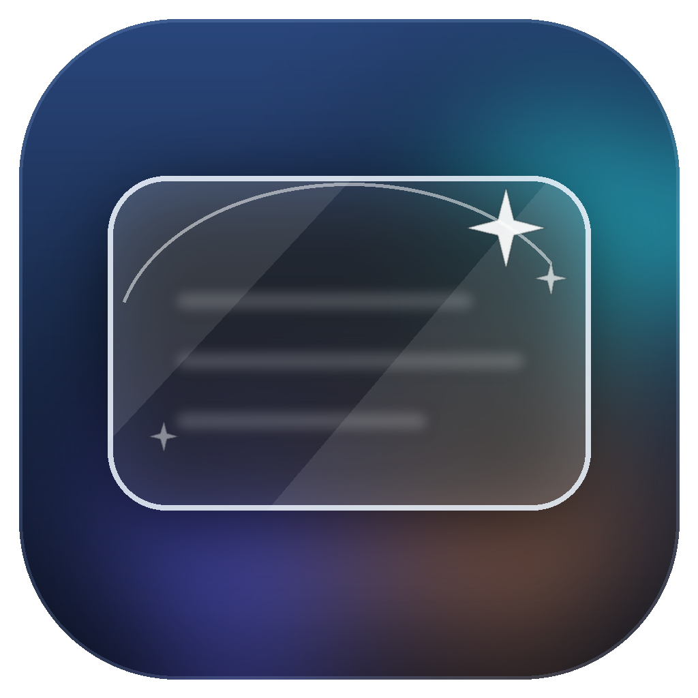

# 毛玻璃 · FrostGlass



一个轻量的 Windows 隐私遮挡工具：在屏幕上框出一块矩形区域，用**实时磨砂效果**遮住它。

磨砂中间同时保持**鼠标和键盘穿透**，不会影响下方窗口的点击、滚轮和打字；需要调整时，拖动顶部标题栏或边框即可。

> 适用场景：遮挡聊天窗口、邮箱、文档里的敏感内容，让屏幕前的人还能辨认，而稍远的人看不清。

## 功能

- 实时、可调清晰度的磨砂遮挡（不是静态截图）
- 玻璃中间完全鼠标穿透，点击、滚轮、打字直达下方窗口
- 半透明 Windows 风格标题栏：拖动移动，右上角设置 / 最小化 / 关闭
- 拖动四边或四角调整大小
- 可调清晰度（40%–100%）和透明度
- 标题栏平时低存在感，鼠标移上去自动变清晰
- 可选“按住调整”快捷键：默认 `Ctrl+Alt`，按住时从玻璃内部任意拖动/缩放
- 总在最上层开关
- 系统托盘、全局快捷键
- 下次启动可复用上次区域（按 `Enter`）

## 下载

便携版（Windows，无需安装）：

**[下载毛玻璃 v1.0.0 便携版](dist/毛玻璃-v1.0.0-便携版.zip)**

也可以在 [Releases](https://github.com/IvesCY/FrostGlass/releases) 页面下载最新版本。

解压后双击 `毛玻璃.exe`。`毛玻璃.exe.config` 必须和 exe 放在同一个文件夹。

### 系统要求

- 建议 **Windows 11**
- Windows 10 2004 及以上基本可用
- 需要 **.NET Framework 4.8**（Windows 10/11 通常已自带）
- 不需要管理员权限

> 程序未做数字签名，从网络下载后首次运行可能出现「Windows 已保护你的电脑」。确认来源后点「更多信息」→「仍要运行」。

## 使用

1. 第一次启动时，按住鼠标左键拖出一个矩形区域。
2. 拖动顶部标题栏移动；拖动四边或四角缩放。
3. 右上角从右到左依次是：**关闭 ×、最小化 −、设置**。
4. 单击托盘图标也可以打开设置。
5. 以后的启动会显示上次区域的虚线框，按 `Enter` 直接复用。

| 操作 | 效果 |
| --- | --- |
| 拖动标题栏 | 移动 |
| 拖动四边/四角 | 缩放 |
| 设置图标（滑杆） | 打开设置面板 |
| 最小化 | 隐藏到系统托盘 |
| 关闭 | 退出程序 |
| `Ctrl+Alt+G` | 显示 / 隐藏 |
| `Ctrl+Alt+R` | 重新框选区域 |
| `Esc` | 取消框选 / 关闭设置 |

设置面板中还可以调整清晰度、透明度、总在最上层，以及“按住调整”的组合键。

## 实现概要

- `FrostPane` 是真正覆盖屏幕的玻璃窗口：约每秒 10 次采样框内画面，用本地快速模糊算法处理，再叠一层雾色。它使用 `WS_EX_LAYERED | WS_EX_TRANSPARENT`，因此主体完全穿透。
- `PaneBar` 是独立的半透明标题栏窗口，负责拖动、顶部缩放和设置/最小化/关闭按钮。
- `PaneResizer` 是沿左右和底部边缘的透明输入窗口，只捕获边框附近的鼠标用于缩放，中间区域不属于它。
- 采样时通过 `SetWindowDisplayAffinity(WDA_EXCLUDEFROMCAPTURE)` 暂时排除自身，避免拍到玻璃自己；画面只在内存中处理，不保存、不上传。
- 纯 WinForms + .NET Framework 4.8，无第三方依赖。

更多设计与开发过程见 [docs/开发记录.md](docs/开发记录.md)。

## 从源码构建

源码在 `src/`。系统自带 .NET Framework 4.8 即可编译，不需要 Visual Studio。

双击 `build.bat`，或在 PowerShell 中运行：

```powershell
.\build.ps1
```

生成 `毛玻璃.exe`。

## 项目结构

```
.
├─ src/                  C# 源码
├─ assets/               图标
├─ docs/                 开发记录、GitHub 上传说明
├─ dist/                 便携版下载包
├─ build.ps1 / build.bat 构建脚本
├─ app.manifest          DPI 与系统兼容性清单
└─ 毛玻璃.exe.config     运行时配置
```

## 已知限制

- 实时预览约 10 帧/秒；快速滚动或视频会有轻微卡顿感。
- 这是**视觉遮挡**，不是安全边界。某些直接窗口抓取或特殊录屏方式可能绕过它，不要用于必须绝对保密的信息。
- 不支持 Windows 7/8 这类旧系统。
- 多显示器与混合 DPI 环境尚未充分测试。

## 许可

[MIT](LICENSE)

## 致谢

这个项目由用户与 **Claude Code**（Anthropic 的 AI 编程助手）在 2026 年 10 月协作完成。设计、实现、调试、打包文档都经历了多轮迭代，记录见 [开发记录](docs/开发记录.md)。
